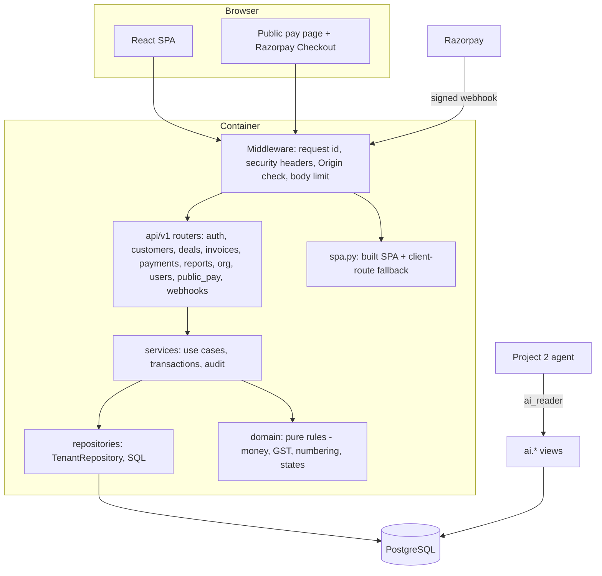

# Architecture

## System view

Rules held by tests (`tests/security/test_architecture.py`): `api → services → repositories → db`; `domain` imports nothing from the
app; services and api never import SQLAlchemy; no string-built SQL reaches `text()` or `execute()`; `system_scope` call sites are a
fixed list.

## Data model (11 tables)

`organizations`, `users`, `customers`, `deals`, `invoices`, `invoice_items`, `invoice_sequences`, `payment_orders`, `payments`,
`webhook_events`, `audit_logs`. All but `organizations` carry `org_id` and composite `(org_id, id)` foreign keys. `audit_logs`
is insert-and-select only for the runtime role. Three roles: `revops_owner` (DDL, migrations), `revops_app` (DML), `ai_reader`
(SELECT on `ai.*` only).

## Data flow: lead to cash

1. A deal is moved to *won*; `POST /deals/{id}/create-invoice` creates a draft invoice (one active invoice per deal).
2. The editor edits items; `POST /invoices/preview` returns server-computed GST. `PUT` saves with the draft's `version`.
3. `POST /invoices/{id}/issue` locks the organisation's sequence row, assigns `INV/yy-yy/nnnnnn`, sets issue and due dates (IST).
4. `POST /invoices/{id}/pay-link` stores only the SHA-256 of a random token and returns the URL once (valid 30 days; a new link replaces the old).
5. The payer opens `/pay/<token>`; `GET /public/pay/{token}` (identical 404 for unknown or expired), `POST .../order` creates a
   Razorpay order for the amount due and stores it, Checkout runs in the browser, `POST .../confirm` verifies
   `HMAC(order_id|payment_id)` against the **server-stored** order id and answers "pending".
6. Razorpay sends `payment.*` webhooks. The handler verifies `HMAC-SHA256(raw body)`, claims the event id, locks the invoice,
   checks amount and currency, upserts the payment, recomputes `amount_paid`, writes audit rows, and answers 200 even for duplicates.
7. The pay page polls until the invoice shows paid; reports and the `ai` views read the same tables.

## Threats considered

| Threat | Mitigation | Evidence |
|---|---|---|
| **Webhook spoofing** | HMAC-SHA256 over the raw body, constant-time compare, event id required | signature tests, E2E forged-webhook spec; breaking `verify_webhook` fails it |
| **Replay / duplicates / reordering** | unique event id claim, row lock, monotonic status, derived balances | 54 webhook tests incl. concurrent deliveries; B10 proof (6 tests fail when idempotency is broken) |
| **Amount tampering** | server-side order amount; webhook amount must equal the stored order amount, else quarantine | quarantine tests |
| **Tenant escape** | repository scoping, composite FKs, 404 for foreign ids, leak suite over every route, `ai` views fail closed | leak suite, route-coverage test, view isolation tests; B10 proofs |
| **Token theft / session abuse** | HttpOnly SameSite cookie, no token in JS storage (UI test), 60 min TTL, `token_version` revocation, Origin check, login rate limits, no tokens in logs | auth and cookie tests, UI storage test |
| **Pay-link guessing** | 256-bit random token, only its hash stored, rate limit, identical 404s | public pay tests |
| **Privilege escalation** | permission enum + `requires()` on every route; route-table test fails if a route declares neither a permission nor `public` | RBAC matrix test over all roles and routes |
| **SQL injection** | bound parameters; architecture test forbids string-built SQL; ruff S608 | architecture test |
| **Secrets in the repo** | gitleaks config and CI step (WROTE-NOT-RUN), `.env` ignored, fake values only | CI config |

## Operations

`/healthz` (process up) and `/readyz` (database reachable and Alembic at head), JSON logs with a request id on every line,
statement timeout on the database, migrations as a pipeline step with the owner role. See `docs/runbook.md`.
